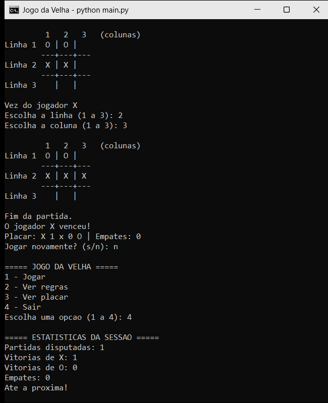
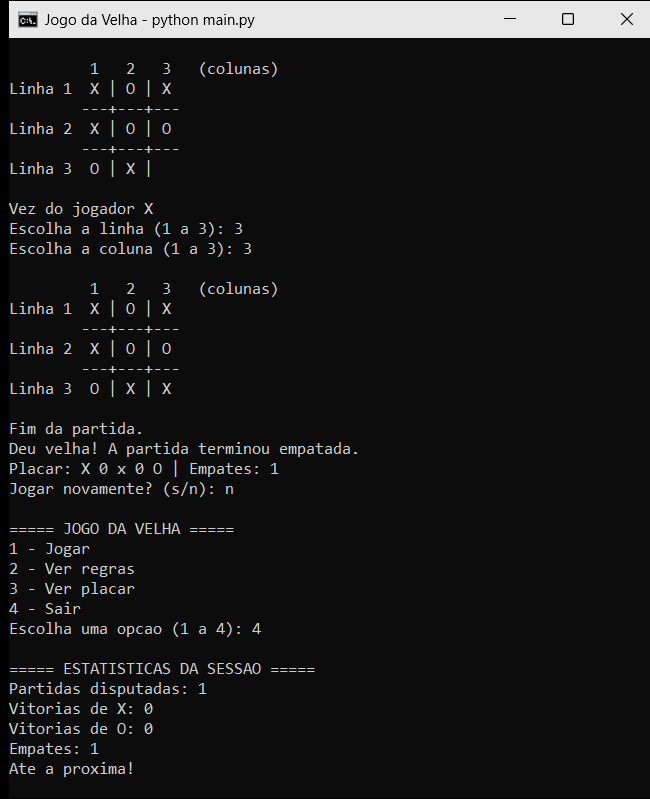

# Relatório de programação — Jogo da Velha

**Integrante:** Pedro  
**Projeto:** Jogo da Velha em Python, executado no terminal  
**Repositório:** [pgshift006-maker/jogo-da-velha](https://github.com/pgshift006-maker/jogo-da-velha)

## Verificação de vitória com `for` aninhado

Depois de cada jogada, o programa verifica se o símbolo atual completou uma linha. O `for` externo percorre as três linhas. Para cada linha, o `for` interno visita suas três casas e conta quantas contêm o símbolo atual.

```python
for i in range(3):
    marcadas = 0
    for j in range(3):
        if tabuleiro[i][j] == simbolo:
            marcadas = marcadas + 1
    if marcadas == 3:
        vencedor = simbolo
```

### Teste de mesa

Considere a jogada em que X completa a segunda linha. Antes de verificar essa linha, `simbolo` vale `"X"` e `vencedor` vale `""`.

```text
     1   2   3
  1  O | O |  
  2  X | X | X
  3    |   |  
```

| Etapa | `i` | `j` | Casa visitada | É X? | `marcadas` | `vencedor` |
|---:|---:|---:|---|---|---:|---|
| 1 | 0 | — | início da linha | — | 0 | `""` |
| 2 | 0 | 0 | `tabuleiro[0][0]` = O | não | 0 | `""` |
| 3 | 0 | 1 | `tabuleiro[0][1]` = O | não | 0 | `""` |
| 4 | 0 | 2 | `tabuleiro[0][2]` = espaço | não | 0 | `""` |
| 5 | 0 | fim | `marcadas == 3` | não | 0 | `""` |
| 6 | 1 | — | início da linha | — | 0 | `""` |
| 7 | 1 | 0 | `tabuleiro[1][0]` = X | sim | 1 | `""` |
| 8 | 1 | 1 | `tabuleiro[1][1]` = X | sim | 2 | `""` |
| 9 | 1 | 2 | `tabuleiro[1][2]` = X | sim | 3 | `""` |
| 10 | 1 | fim | `marcadas == 3` | sim | 3 | `"X"` |
| 11 | 2 | — | início da linha | — | 0 | `"X"` |
| 12 | 2 | 0 | `tabuleiro[2][0]` = espaço | não | 0 | `"X"` |
| 13 | 2 | 1 | `tabuleiro[2][1]` = espaço | não | 0 | `"X"` |
| 14 | 2 | 2 | `tabuleiro[2][2]` = espaço | não | 0 | `"X"` |
| 15 | 2 | fim | `marcadas == 3` | não | 0 | `"X"` |

**Resultado:** `vencedor` fica com `"X"`. O laço interno visita nove casas ao todo (três em cada uma das três linhas). `marcadas` volta a zero no início de cada linha, então a contagem não mistura casas de linhas diferentes.

O programa usa lógica semelhante para as colunas: o laço externo escolhe a coluna e o interno percorre as linhas. Para as diagonais, um laço percorre `tabuleiro[i][i]` (diagonal principal) e `tabuleiro[i][2 - i]` (diagonal secundária).

## Operadores

| Operador | Exemplo no programa | Função |
|---|---|---|
| `=` | `vencedor = simbolo` | Atribui um valor à variável. |
| `+` | `marcadas = marcadas + 1` | Soma um ao contador; também concatena textos nas mensagens. |
| `-` | `tabuleiro[i][2 - i]` | Calcula a coluna da diagonal secundária. |
| `==` | `jogadas == 9` | Compara se dois valores são iguais. |
| `!=` | `vencedor != ""` | Compara se dois valores são diferentes. |
| `or` | `diagonal_principal == 3 or diagonal_secundaria == 3` | Une condições; basta uma ser verdadeira. |

## Estruturas `if`, `elif` e `else`

Depois de verificar vitória, o programa decide se encerra ou continua a partida:

```python
if vencedor != "":
    partida_ativa = False
elif jogadas == 9:
    partida_ativa = False
else:
    if simbolo == "X":
        simbolo = "O"
    else:
        simbolo = "X"
```

- `if`: se houver vencedor, encerra a partida.
- `elif`: se ninguém venceu e as nove casas foram preenchidas, encerra em empate.
- `else`: se ainda houver casas e ninguém venceu, troca o símbolo para o próximo jogador.

Somente um dos blocos externos é executado. A vitória é verificada antes do empate; assim, uma vitória na nona jogada é reconhecida como vitória.

## Evidências de execução

Executei `main.py` com uma sequência de jogadas que termina em vitória de X e outra que termina em empate. Para que o teste possa ser repetido, as respostas foram fornecidas por um roteiro de entradas que as exibe na tela como se tivessem sido digitadas; o código de `main.py` não foi alterado para isso. As saídas completas estão em [evidencias/vitoria.txt](evidencias/vitoria.txt) e [evidencias/empate.txt](evidencias/empate.txt). A sessão em que as duas partidas acontecem em sequência (com revanche, consulta ao placar e estatísticas ao sair) está em [evidencias/sessao.txt](evidencias/sessao.txt).

### Vitória de X

X completa a linha 2 com a jogada na linha 2, coluna 3. O programa mostra o tabuleiro final, a mensagem de vitória e o placar.



### Empate

O tabuleiro termina cheio, sem linha, coluna ou diagonal completa. O programa declara empate e soma um em "Empates".


